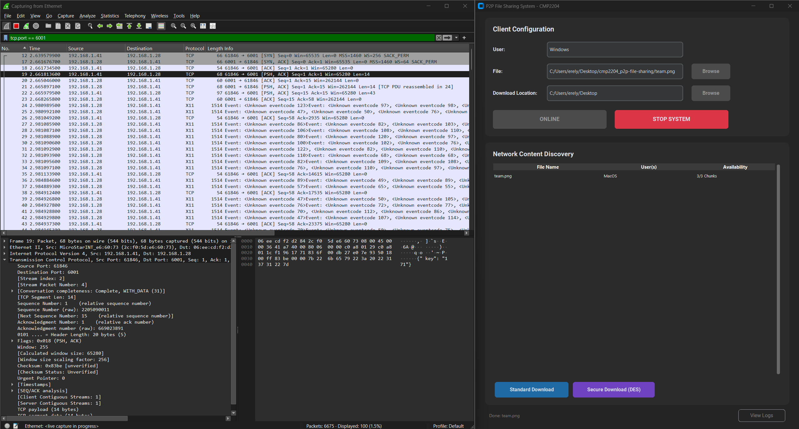
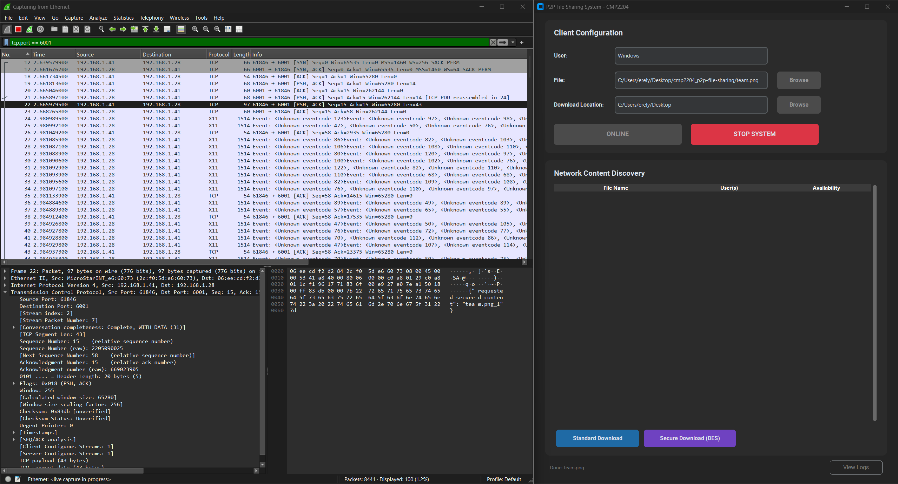
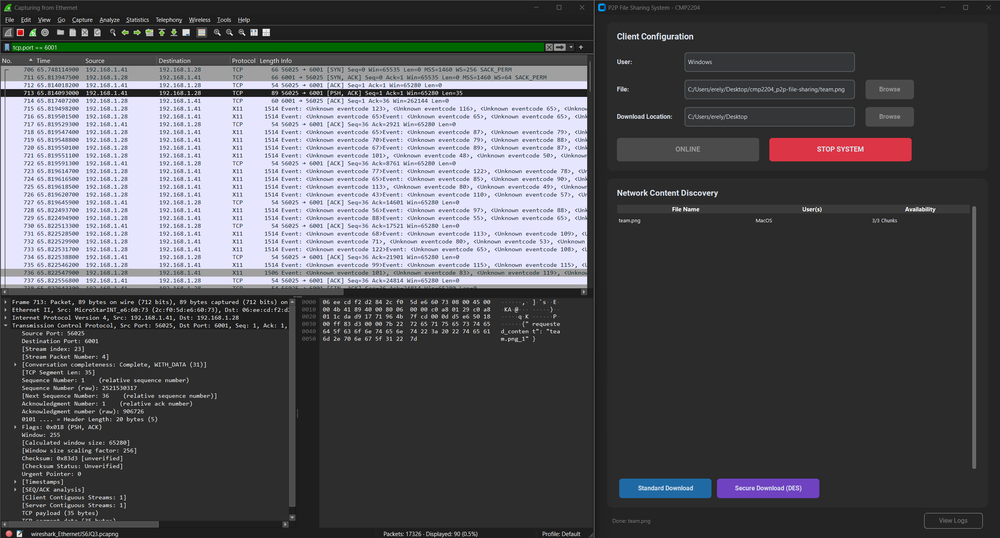

# p2p-file-sharing

A decentralized peer-to-peer file-sharing application for a local network, built in Python on raw UDP and TCP sockets. Peers find each other with UDP broadcasts, download files in chunks over TCP, and can optionally encrypt each transfer with a key agreed through **Diffie-Hellman**.

Built as a two-person team project for a Computer Networks course (Spring 2026).

## How it works

Each peer runs four background threads:

| Thread | Protocol | Job |
|---|---|---|
| Chunk Announcer | UDP broadcast, port `6000` | Every 8 seconds, broadcasts a JSON message with the peer's name and the chunks it holds |
| Content Discovery | UDP, port `6000` | Listens for announcements and keeps a live map of which peer has which chunk |
| Chunk Uploader | TCP, port `6001` | Serves chunks to other peers, plain or encrypted |
| Chunk Downloader | TCP, port `6001` | Requests every chunk of a file from the peers that have it, then reassembles the file |

A hosted file is split into 3 chunks (`name_1`, `name_2`, `name_3`). Every chunk a peer downloads is announced again, so the network gets more sources as more peers download a file.

### Secure download

1. The downloader picks a secret `a` and sends `A = g^a mod p` to the uploader.
2. The uploader picks a secret `b`, replies with `B = g^b mod p`, and both sides compute the shared secret `s = g^(ab) mod p`. The secret itself never goes over the wire.
3. The uploader encrypts the chunk with **DES** using a key derived from `s`, Base64-encodes it, and sends it. The downloader decrypts it with the same key.

The captures in [`docs/`](docs) show the difference in Wireshark: the plain transfer shows file contents in cleartext, the secure one shows only the key exchange and ciphertext.

| Key exchange | Encrypted transfer | Unencrypted transfer |
|---|---|---|
|  |  |  |

## Security notes

The protocol follows the course specification, which was designed for learning, not real-world use. If I were to harden it:

- **Tiny DH parameters** (`p = 907`, `g = 7`): the discrete log can be brute-forced instantly. Real deployments use 2048-bit groups (RFC 3526) or X25519.
- **No authentication**: an attacker on the LAN can sit in the middle of the key exchange, or spoof announcements to advertise chunks it doesn't have. Signing the DH values fixes the first problem.
- **DES in ECB mode**: DES has a 56-bit key, and ECB leaks patterns in the plaintext. AES-GCM would give both confidentiality and integrity.
- **No integrity check**: a peer can serve a modified chunk. Publishing a SHA-256 hash per chunk would catch it.

## Usage

Requires Python 3.8+.

```bash
pip install pyDes customtkinter
python gui.py
```

1. Make sure all peers are on the same LAN and ports `6000/udp` and `6001/tcp` are allowed by the firewall.
2. Enter a username, choose a file to host, and click **Initialize System**.
3. Files found on the network appear in the list. Select one and choose **Standard** or **Secure Download**.
4. Keep the app running to keep serving the chunks you downloaded. Use **Stop System** to change your username or hosted file.

## Project layout

```
p2p_file_sharing.py   # PeerNode: sockets, threads, DH key exchange, DES encryption
gui.py                # customtkinter front end
docs/                 # Wireshark captures
```

## Known limitations

- Two instances can't run on one machine because both need ports 6000 and 6001. Test with two devices or a bridged VM.
- Discovery uses subnet broadcast, so peers on different subnets or over the internet won't see each other.
